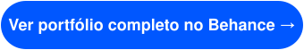

 

 

<table align="center">
  <tr>
    <td align="center" width="33%" valign="top">
      
    </td>
    <td align="center" width="33%" valign="top">
      
    </td>
    <td align="center" width="33%" valign="top">
      
    </td>
  </tr>
</table>

  

 

 

 

 

 

  
  &nbsp;&nbsp;
  
  <!-- LinkedIn: adicionar o link do perfil quando quiser exibir -->

 

  Building at the intersection of <b>code × design × experience</b>.

