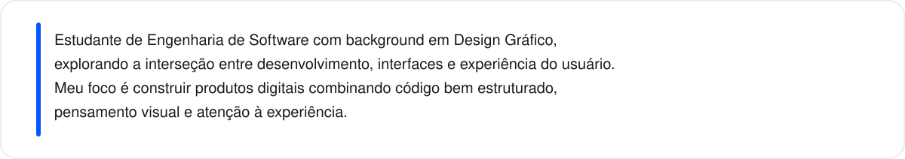

 

 

<table align="center">
  <tr>
    <td align="center" width="33%">
      
       
      <b>Portfólio de desenhos à mão</b>
    </td>
    <td align="center" width="33%">
      
       
      <b>Portfólio</b>
    </td>
    <td align="center" width="33%">
      
       
      <b>Saturno</b>
    </td>
  </tr>
</table>

  

 

 

 

 

  <picture>
    <source media="(prefers-color-scheme: dark)" srcset="https://streak-stats.demolab.com?user=NandoDesign&hide_border=true&theme=dark" />
    
  </picture>

 

  
  &nbsp;
  
  <!-- LinkedIn: adicionar o link do perfil quando quiser exibir -->

 

  Building at the intersection of <b>code × design × experience</b>.

