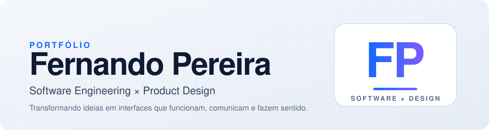

<div align="center">



<br/>

**[Trabalhos](#trabalhos)** &nbsp;·&nbsp; **[Stack](#stack)** &nbsp;·&nbsp; **[Foco](#foco)** &nbsp;·&nbsp; **[Formação](#formação)** &nbsp;·&nbsp; **[Contato](#contato)**

</div>

<br/>

Estudante de **Engenharia de Software** com background em **Design Gráfico**, explorando a interseção entre desenvolvimento, interfaces e experiência do usuário.

Meu foco é construir produtos digitais combinando **código bem estruturado**, **pensamento visual** e **atenção à experiência**.

---

## Trabalhos

<table align="center">
  <tr>
    <td align="center" width="33%">
      <a href="https://www.behance.net/gallery/246571711/Portifolio-de-desenhos-a-mao">
        
      </a>
      <br/>
      <sub><b>Portfólio de desenhos à mão</b></sub>
    </td>
    <td align="center" width="33%">
      <a href="https://www.behance.net/gallery/246519147/Portifolio">
        
      </a>
      <br/>
      <sub><b>Portfólio</b></sub>
    </td>
    <td align="center" width="33%">
      <a href="https://www.behance.net/gallery/161641475/saturno">
        
      </a>
      <br/>
      <sub><b>Saturno</b></sub>
    </td>
  </tr>
</table>

<p align="center">
  <a href="https://www.behance.net/NandoDesign-real">
    
  </a>
</p>

---

## Stack

<table>
  <tr>
    <td width="33%" valign="top">
      <b>Front-end</b><br/><br/>
      
      
      
    </td>
    <td width="33%" valign="top">
      <b>Design &amp; Produto</b><br/><br/>
      
      
      
      
      
    </td>
    <td width="33%" valign="top">
      <b>Workflow</b><br/><br/>
      
      
      
    </td>
  </tr>
</table>

---

## Foco

```text
Software Engineering  +  Visual Design
              ↓
          Interfaces
              ↓
       User Experience
              ↓
      Digital Products
```

* Engenharia de Software e Arquitetura Limpa
* Organização de interfaces, UI/UX e Design de Produto
* Versionamento com Git/GitHub e desenvolvimento orientado a projetos

> **"Design defines the experience. Code makes it real."**

Gosto de conectar dois universos complementares. **Design** cuida de hierarquia visual, composição, tipografia, motion design, identidade de marca e UX. **Engenharia** cuida de código limpo, componentização, manutenibilidade, versionamento e performance.

O objetivo não é só uma interface bonita, e sim uma interface que **funcione de forma impecável para quem a utiliza**.

---

## Formação

| Curso | Instituição | Período |
| :--- | :--- | :--- |
| **Bacharelado em Engenharia de Software** | PUC Minas | 2026 — 2029 |
| **Design Gráfico & Motion** | Escola ZION | Em andamento |

---

## GitHub em números

<p align="center">
  <picture>
    <source media="(prefers-color-scheme: dark)" srcset="https://streak-stats.demolab.com?user=NandoDesign&hide_border=true&theme=dark" />
    
  </picture>
</p>

---

## Contato

Estou aberto a oportunidades, projetos colaborativos e conversas sobre tecnologia, design e produtos digitais.

<p align="center">
  <a href="https://www.behance.net/NandoDesign-real">
    
  </a>
  &nbsp;
  <a href="mailto:nandopv12@gmail.com">
    
  </a>
  <!-- LinkedIn: adicionar o link do perfil quando quiser exibir -->
</p>

<br/>

<div align="center">
  <sub>Building at the intersection of <b>code × design × experience</b>.</sub>
</div>
